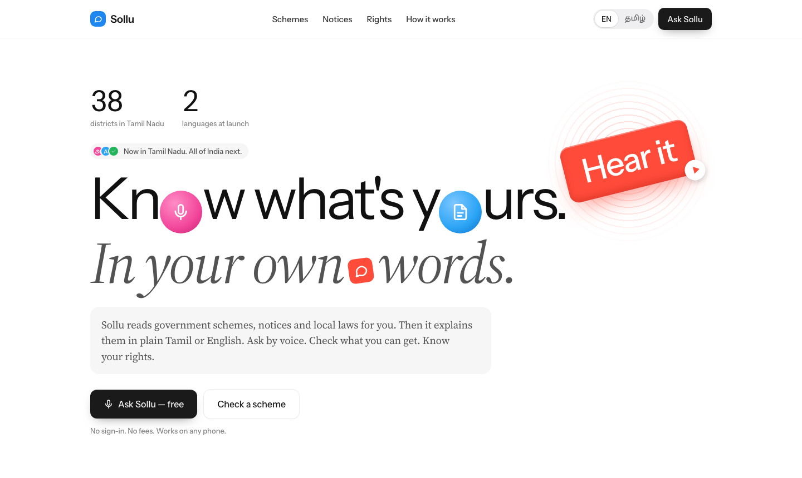
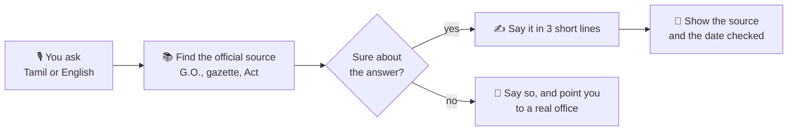

<div align="center">

<a href="https://sollu-ai.vercel.app"></a>

### Know what's yours. *In your own words.*

உங்களுக்கு உரியதை தெரிஞ்சுக்கோங்க — உங்க சொந்த வார்த்தையில.

[](https://sollu-ai.vercel.app)
[](tsconfig.json)
[](package.json)
[](vite.config.ts)
[](#roadmap)
[](LICENSE)

**[▶ See it live](https://sollu-ai.vercel.app)** · [Why Sollu](#why-sollu) · [What's real today](#whats-real-today) · [Run it](#run-it) · [Design notes](#design-notes) · [Roadmap](#roadmap) · [AI use](#ai-use-and-responsibility)

</div>

<br>

**Sollu** (சொல்லு, *"say it"*) reads government schemes, notices and local laws. Then it explains them in plain Tamil or English. You can ask by voice, check what you can get, and learn your rights.

It starts in **Tamil Nadu**. Then it grows to **all of India**, one state at a time.

<p align="center">
  <a href="https://sollu-ai.vercel.app"></a>
</p>

## Why Sollu

The rules that decide what people get from the government are written in a language most people don't read. Long PDFs. Legal English. Formal Tamil. G.O. numbers.

So a 62-year-old who could get a pension often doesn't know it. A farmer gets a notice and can't tell if it's about their land. A worker whose pay is late doesn't know they can complain for free. Many people end up paying a middleman just to read a page.

Sollu's job is simple: **read the rule for you, then say it the way you'd say it.**

## What it does

Each action has one plain verb. We never swap it for a fancier word.

| | Verb | What you do | What you get |
|:-:|---|---|---|
| 🎙️ | **Ask** | Speak in Tamil or English | An answer in your words, read aloud |
| ✅ | **Check** | Answer 5 quick questions | Every scheme you may fit, and why |
| 📄 | **Explain** | Snap a photo of a notice | What it says, what to do, and by when, in 3 lines |
| ⚖️ | **Know** | Ask about rent, wages, ration or police | The plain rule and what you can do today |
| 📋 | **Find** | Ask where to go | The papers you need and the nearest office |

<p align="center">
  
</p>

## What's real today

I'd rather show you an honest list than a big promise.

| Part | Status |
|---|---|
| Landing page (English + Tamil, phone + desktop) | ✅ Live at [sollu-ai.vercel.app](https://sollu-ai.vercel.app) |
| Product plan, user flows and copy for every page | ✅ Done, in [FLOW.md](FLOW.md) |
| "Hear it" button that reads a sample answer aloud | ✅ Works, using your browser's own voice |
| The AI helper that answers real questions | 🟠 Not built yet |
| Scheme data checked against the source G.O.s | 🟠 Not started |

Every demo card on the page says **Sample**. There are no fake users, ratings or testimonials. Real ones come after the pilot.

## How Sollu will answer

This is the plan for the AI helper. It isn't built yet.



Three rules sit under every answer:

1. **Show the source.** Every answer names its document and the date we last checked it.
2. **Say "I'm not sure".** When it isn't sure, it says so and sends you to a person.
3. **Not legal advice.** For a legal case, it connects you to free legal aid.

## Run it

You need Node 20.19+ or 22.12+.

```bash
git clone https://github.com/rmagdaleena2508-01/Sollu.git
cd Sollu
npm install
npm run dev
```

Then open the address Vite prints (usually `http://localhost:5173`).

```bash
npm run build      # strict type check + production build into dist/
```

<details>
<summary><b>Project map</b></summary>

<br>

```text
sollu/
├── src/
│   ├── content.ts        ← every word on the page, typed. Change copy here.
│   ├── hooks.ts          ← language, voice, reveal-on-scroll, reduced motion
│   ├── styles.css        ← one stylesheet with design tokens on :root
│   ├── App.tsx
│   └── components/
│       ├── Nav.tsx           EN / தமிழ் switch
│       ├── Hero.tsx          icons inside the headline + "Hear it" sticker
│       ├── WhatItDoes.tsx    Check · Explain · Ask demo cards
│       ├── Sections.tsx      features, sources, roadmap, FAQ
│       ├── Personas.tsx      seniors, farmers, students, workers, women
│       ├── SampleFan.tsx     fanned stack of sample questions
│       ├── Footer.tsx        blue fade, giant wordmark, draggable stickers
│       └── Icon.tsx          one SVG sprite, recolours with currentColor
├── prototype/index.html  ← the first single-file version
├── FLOW.md               ← sitemap, user flows, word rules, all page copy
└── docs/                 ← images for this README
```

</details>

## Design notes

These are the choices that make Sollu feel like Sollu.

**Plain words, always.** The copy reads at a third-grade level. Short sentences. Numbers as digits. Banned words: *empower, leverage, unlock, seamless, cutting-edge.* If a word needs explaining, it's the wrong word.

**Two voices.** A sans font ([Instrument Sans](https://fonts.google.com/specimen/Instrument+Sans)) *announces*: headlines and buttons. A serif ([Source Serif 4](https://fonts.google.com/specimen/Source+Serif+4)) *explains*: the longer lines. [Noto Sans Tamil](https://fonts.google.com/noto/specimen/Noto+Sans+Tamil) carries every Tamil line.

**Voice first, text always.** The mic gets the biggest button. Every answer can be heard *and* read.

**Playful where it's safe, calm where it matters.** The stickers and the giant wordmark are there to make a government topic feel friendly. The parts about money and rights stay calm and clear.

**Motion that gets out of the way.** Things rise in once, then stop. Buttons press down a little when tapped. If your phone asks for less motion, the page listens.

**Honest by default.** Sample UI is labelled "Sample". Nothing on the page claims users we don't have.

<details>
<summary><b>Where the look came from</b></summary>

<br>

- **Layout ideas:** a lead-generation landing page shot on Dribbble. From it came the big numbers, the icons inside the headline letters, the tilted stickers, the bento cards and the fanned card stack.
- **Footer idea:** [stickitupx.com](https://stickitupx.com). From it came the giant white wordmark on a blue fade with stickers you can drag.
- No art or code was copied from either. The stickers and icons are drawn as SVG in this repo.

</details>

## Roadmap

**Version 1 — Tamil Nadu**

- [x] Landing page in English and Tamil
- [x] Product flow and copy for every page ([FLOW.md](FLOW.md))
- [ ] Ask screen with voice in and voice out
- [ ] Scheme check: 5 questions → schemes you may fit
- [ ] Explain a notice from a photo or PDF
- [ ] Rights library for everyday problems
- [ ] Source card on every answer
- [ ] Pilot with real people, then replace the samples with real stories (with consent)

**Version 2 — All of India**

- [ ] 22 Indian languages
- [ ] Every state's schemes, one state at a time
- [ ] Missed-call and WhatsApp access
- [ ] Tools for NGOs and e-Sevai helpers

## Help wanted

The most useful help isn't code.

- **Tamil speakers:** read the Tamil lines and tell me where they sound stiff or wrong.
- **People who work with schemes** (e-Sevai operators, NGO staff, ward volunteers): tell me which questions people actually ask.
- **Developers:** issues and pull requests are welcome. Please keep the copy plain and the claims honest.

## Credits

| What | Where it's from | License |
|---|---|---|
| Instrument Sans, Noto Sans Tamil, Source Serif 4, Geist Mono | [Fontsource](https://fontsource.org) | SIL OFL 1.1 |
| React, Vite, TypeScript | npm | MIT / Apache-2.0 |
| Badges | [shields.io](https://shields.io) | CC0 |

## AI use and responsibility

In creating this project, I collaborated with **Claude Code (Anthropic's Claude Opus 5.5)**, the only AI tool I used, to assist with research, writing code, finding and fixing bugs, and drafting documentation.

**What I did myself:** I came up with the idea: an AI that explains government notices, schemes and local laws in plain language and regional languages, starting with Tamil Nadu and then all of India. I picked the two design references (the Dribbble landing page and the Stick It Up footer) and asked for the same white wordmark and blue fade. I asked for the step-by-step flow and for words chosen carefully so the product is clear. I looked at other names and chose to keep "Sollu". I asked for the TypeScript rebuild to match the first version pixel for pixel, chose the public repo, and picked the sollu-ai.vercel.app address.

**What the AI helped with:**

- Writing the product flow, sitemap, word rules and page copy in FLOW.md, based on my brief
- Designing and building the first HTML version, then the TypeScript and React version
- Drawing the SVG stickers and icons, and picking open-source fonts
- Suggesting names, with their meanings and risks
- Running checks: type checks, builds, screenshots, a pixel-by-pixel compare between the two versions, and phone-size tests
- Setting up GitHub and Vercel, and drafting this README and the commit messages, which I then edited and approved

**How I reviewed it:** I looked at the screenshots at each step and gave direction, like asking for the footer to match my reference and for the TypeScript version to match the first one exactly. The TypeScript version was compared to the first version with a screenshot diff before it shipped. Anything not built yet is marked 🟠 in [What's real today](#whats-real-today), and every demo card on the site is labelled "Sample".

I affirm that all AI-generated and co-created content underwent thorough review and evaluation. The final output accurately reflects my understanding, expertise, and intended meaning. While AI assistance was instrumental in the process, I maintain full responsibility for the content, its accuracy, and its presentation.

**Context:** This is a personal portfolio project and an early product idea. It is not a school assignment, not a product of any company, and not a government service. The scheme examples on the site are samples, not checked facts. This disclosure is made in the spirit of transparency and to acknowledge the role of AI in the creation process.

## License

[MIT](LICENSE) for the code. You can use it, change it and share it. Just keep the license file. The fonts keep their own licenses.

<br>

<div align="center">

**Ask it. Know it.** · Made in Tamil Nadu · சொல்லு

</div>
