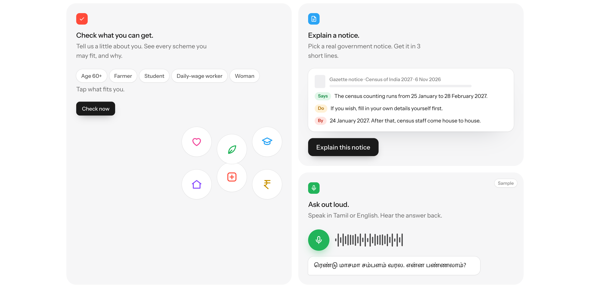
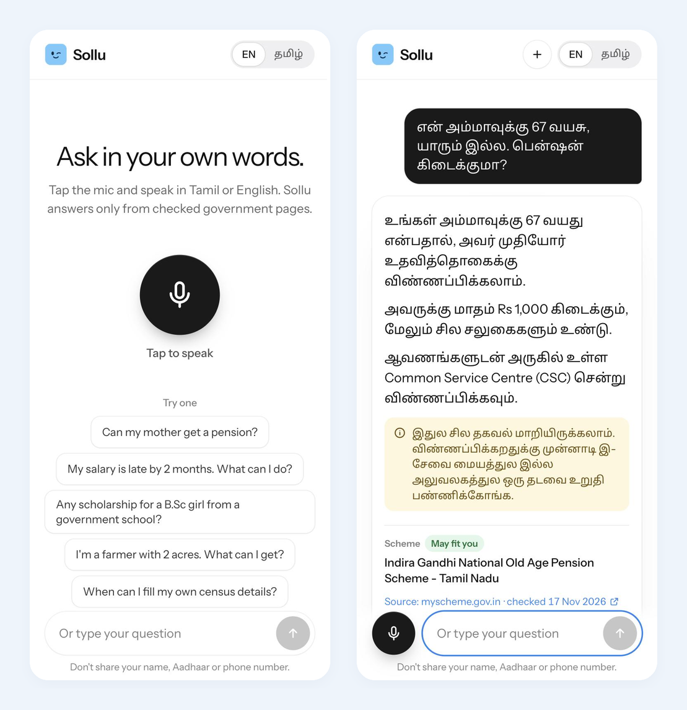
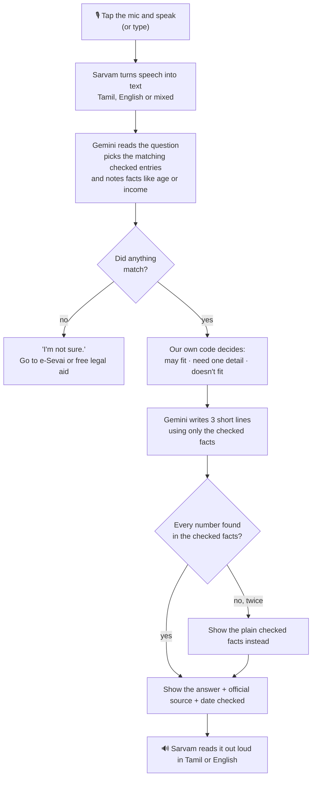

<div align="center">

<a href="https://sollu-ai.vercel.app"></a>


### Know what's yours. *In your own words.*

உங்களுக்கு உரியதை தெரிஞ்சுக்கோங்க — உங்க சொந்த வார்த்தையில.

[](https://sollu-ai.vercel.app)
[](tsconfig.json)
[](package.json)
[](vite.config.ts)
[](#voice-first-text-always)
[](data/README.md)
[](LICENSE)

**[▶ See it live](https://sollu-ai.vercel.app)** · [Why Sollu](#why-sollu) · [What's real today](#whats-real-today) · [Voice first](#voice-first-text-always) · [When things fail](#when-things-fail) · [How I built it](#how-i-built-it) · [How I tested it](#how-i-tested-it) · [Build log](#build-log) · [Run it](#run-it) · [AI use](#ai-use-and-responsibility)

</div>

<br>

**Sollu** (சொல்லு, *"say it"*) reads government schemes, notices and local laws. Then it explains them in plain Tamil or English. You can ask by voice, check what you can get, and learn your rights.

It starts in **Tamil Nadu**. Then it grows to **all of India**, one state at a time.

<p align="center">
  <a href="https://sollu-ai.vercel.app"></a>
</p>

## Why Sollu

The rules that decide what people get from the government are written in a language most people don't read. Long PDFs. Legal English. Formal Tamil. G.O. numbers.

So a 62-year-old who could get a pension often doesn't know it. A farmer gets a notice and can't tell if it's about their land. A worker whose pay is late doesn't know they can complain for free. Many people end up paying a middleman just to read a page.

Sollu's job is simple: **read the rule for you, then say it the way you'd say it.**

> My goal: make public information effortless to discover, government services intuitive to navigate, and statutory policies clear to understand, no matter how comfortable someone is with technology. That's why Sollu is **voice first**, and falls back to text only when voice doesn't work.

## What it does

Each action has one plain verb. We never swap it for a fancier word.

| | Verb | What you do | What you get |
|:-:|---|---|---|
| 🎙️ | **Ask** | Speak in Tamil or English | An answer in your words, read aloud |
| ✅ | **Check** | Answer 5 quick questions | Every scheme you may fit, and why |
| 📄 | **Explain** | Snap a photo of a notice, or tap one of ours | What it says, what to do, and by when, in 3 lines |
| ⚖️ | **Know** | Ask about rent, wages, ration or police | The plain rule and what you can do today |
| 📋 | **Find** | Ask where to go | The papers you need and the nearest office |

<p align="center">
  
</p>

## What's real today

I'd rather show you an honest list than a big promise.

| Part | Status |
|---|---|
| Landing page (English + Tamil, phone + desktop) | ✅ Live at [sollu-ai.vercel.app](https://sollu-ai.vercel.app) |
| Product plan, user flows and copy for every page | ✅ Done, in [FLOW.md](FLOW.md) |
| Official data sources for Tamil Nadu, researched | ✅ Done, in [DATA-SOURCES.md](DATA-SOURCES.md) |
| **Checked demo data:** 19 schemes, 5 rights topics, 3 real notices | ✅ Done, in [data/](data/README.md). Every fact is quoted from an official page |
| **Ask page** at `/ask`: speak or type, get a checked answer read aloud | ✅ Built and tested on my machine ([how](#how-i-tested-it)) |
| Ask page on the live site | ✅ Live and demo-ready: saved demo answers, a health check, and a clear "busy" message ([build log](#build-log)) |
| A person (me) confirming the amounts Sollu says out loud | ✅ Pensions, Magalir Urimai and free bus checked ([what changed](#what-you-should-know)). 🟠 Other amounts still pending |
| **Explain a notice:** 3 real, checked notices on the Ask page (census, rice stock limits, Salem mark sheets). Tap one, get it in 3 lines, read aloud | ✅ Built |
| **Check what you can get** at `/check`: 5 quick questions, then every checked scheme that may fit, why, and the official source | ✅ Built |
| **Explain a notice from a photo:** take or pick a photo on the Ask page; Sollu reads it and explains it in 3 lines, read aloud. 3 example photos of the checked notices work instantly | ✅ Built. Photos are read by AI, so the answer says "not checked by Sollu" unless the photo is one of our checked notices |
| Explain a notice from a PDF, Find an office | 🟠 Not built yet |

Demo cards that are still illustrations say **Sample**. The "Check" card counts real checked schemes. There are no fake users, ratings or testimonials, and no buttons for features that don't exist. Real stories come after the pilot.

## Voice first, text always

<p align="center">
  
</p>

Many people Sollu is for can talk easily but find reading forms hard. So the **mic is the biggest thing on the page**, and every answer is **read out loud by itself**. The text box is always there, right next to the mic, for anyone who would rather type or can't use voice.

### What happens when you ask



1. **You speak.** Tap the mic once and talk. A ring around the mic grows with your voice, so you can see it hears you. When you stop talking, it stops by itself (or tap again, and it never goes past 28 seconds). The audio goes to Sarvam's speech-to-text (`saaras:v4`). It works out the language on its own, so Tamil, English and Tamil-English mixed all work.
2. **You see what Sollu heard.** Your words appear in the text box, with a green *"Sending what I heard…"* bar. If they're right, they send by themselves in about 2 seconds. If not, tap **Edit** (or the text) and fix them first.
3. **Sollu understands.** Gemini reads the question and picks up to 3 entries from the checked data. It also writes down facts you said, like "67 years old" or "family income 1 lakh". It can only pick entries that exist.
4. **Our code decides, not the AI.** Rules in [`server/eligibility.ts`](server/eligibility.ts) compare your facts with each scheme's age, income, gender and community limits. The answer is **may fit**, **need one detail** or **doesn't fit**.
5. **One question at a time.** If a fact is missing, Sollu asks one short, fixed question, like *"அவங்களுக்கு எத்தனை வயசு?"* (How old are they?). You answer, and Sollu remembers the conversation.
6. **Sollu explains.** Gemini writes at most 3 short lines in the language you used, using only the checked facts.
7. **Sollu checks itself.** Every number in the answer must appear in the checked facts or in what you said. Numbers written as words and broken text are rejected too.
8. **You hear it.** Sarvam's text-to-speech (`bulbul:v4-flash`) reads the answer out loud with a Tamil voice. The voice is **streamed**, so it starts in 1 to 2 seconds, while the rest is still being made. Each answer shows the official source link and the date it was checked. Entries a reviewer marked "caution" also say *"confirm at the office before you apply"*.

## When things fail

Voice is the front door, so it can't be the only door. Every step has a backup, and the last backup is always plain text.

| If this fails… | …Sollu does this |
|---|---|
| The phone has no mic, or the person says no to mic access | Says so in plain words and moves the cursor to the text box |
| The browser can't record audio at all | Uses the **browser's own speech recognition** instead, showing the words as you speak |
| That browser has no working speech service either (Brave turns it off) | Says *"Voice isn't working right now"* and moves the cursor to the **text box**, which always works |
| Sarvam's speech service is down | Says *"Voice isn't working right now. Please type"* (not "I couldn't hear you", because it isn't the person's fault) and moves the cursor to the text box |
| The person taps the mic but says nothing | Stops after 8 seconds and asks them to try again. **Nothing is sent**, so no API call is wasted on silence |
| Sollu heard the words wrong | The words wait in the text box for about 2 seconds. Tapping **Edit** stops the sending so they can fix them |
| You talk for more than 28 seconds | Stops at 28 seconds, still answers, and tells you it stopped |
| A Gemini model is slow (common on the free tier) | After 4 seconds, starts the next model **at the same time** and uses whichever answers first (3 models) |
| Every Gemini model is busy | Tries once more by itself, then says *"Sollu is busy right now. Please try again in a minute"* in Tamil or English, instead of a general error |
| The demo questions, when the free tier is busy | They don't use the AI live at all: their answers were made in advance by the same pipeline and come back instantly, with ready-made audio |
| The AI answer has a number that isn't in the checked facts | Asks the AI to write it again. If it fails twice, shows the **plain checked facts** instead |
| Nothing in the checked data matches the question | Says *"I'm not sure"* and points to e-Sevai or free legal aid. **It never guesses** |
| The streamed voice fails | Makes the whole audio file at once instead (slower, but it plays) |
| Sarvam can't make the audio at all | The **phone's own voice** reads the answer |
| The phone blocks audio from playing by itself | The **Hear it** button is always there |
| Too many questions from one place in a minute | Asks the person to wait a minute (protects the free API keys). Set to 40 a minute, because everyone on the same venue Wi-Fi shares one address |

## How I built it

These are the choices I made as a full-stack engineer, and why.

**1. The AI never decides who gets what.** A language model can sound sure and still be wrong. "You can get it" is a high-stakes sentence, so the yes/no decision lives in plain TypeScript rules that anyone can read and test. The AI only does the language work: understanding the question and saying the answer simply.

**2. The AI can only use checked facts.** The 27 entries in [`data/`](data/README.md) came from official sites only (`*.gov.in`, `*.nic.in`, myScheme, CMCHIS). Every fact has a word-for-word quote, and a checker script ([`data/tools/check.py`](data/tools/check.py)) proves each quote exists in the saved page. Gemini gets only the 1 to 3 entries that match, not the whole internet.

**3. Trust, but check the output.** Before an answer is shown, the server pulls every number out of it and looks for each one in the facts. Money amounts are where a wrong answer hurts most, so this check is strict. If it fails, Sollu falls back to the plain facts. A dull right answer beats a friendly wrong one.

**4. "I'm not sure" is a feature.** If the question doesn't match a checked entry (a passport, a stock tip), Sollu says so and sends people to a real office.

**5. Keys never reach the phone.** The Gemini and Sarvam keys live only on the server, in Vercel Functions ([`api/`](api/)). The browser talks to `/api/ask`, `/api/stt` and `/api/tts`, never to Google or Sarvam directly. The same handlers run in local development through a small Vite plugin, so what I test is what ships.

**6. Built for the free tier and slow networks.** Free AI models get busy. I measured them: the bigger Gemini Flash models often answered "high demand" after more than 70 seconds, while Flash-Lite answered in about 2 seconds with good Tamil. So Sollu tries `gemini-3.5-flash-lite` first. If it hasn't answered in 4 seconds, a backup model starts alongside it ("hedging", the same trick big systems use for slow servers), and the first good answer wins. Audio comes back as MP3 (small), and the text shows before the voice starts.

**13. Speak sooner by streaming.** Making the voice for a 3-line Tamil answer took 6 to 7 seconds, and Sollu waited for the whole file before speaking. Making only the first line still took about 4 seconds, so splitting lines wasn't enough. Sarvam's streaming endpoint sends the first audio in about 0.3 seconds, and browsers can play MP3 while it downloads. So `GET /api/tts` passes the stream straight through to the `<audio>` element. If streaming fails, Sollu falls back to the whole file, then to the phone's own voice.

**12. Ready for a busy room.** A demo is the worst time for a free API to be slow, so:
- The questions in the demo script and the sample chips have **saved answers**, made in advance by the same pipeline and checked by me ([`data/demo-answers.json`](data/demo-answers.json), audio in [`public/demo-audio/`](public/demo-audio/)). They come back in milliseconds.
- A saved answer is used only when the question means the same thing word for word and has exactly the same numbers. *"Can my father get a pension?"* never gets the answer saved for *"Can my mother get a pension?"*, and *"72"* never gets the answer for *"67"*.
- Recent live answers are kept in memory, so the same question twice is instant.
- `GET /api/health` wakes the server, and the Ask page calls it when it opens. `GET /api/health?deep=1` makes one tiny Gemini call and one tiny Sarvam call and times them. Run it just before going on stage.

**7. Privacy by default.** Questions go to Gemini with storage turned off (`store: false`). Nothing is saved in a database. The page reminds people not to say their name, Aadhaar or phone number.

**8. Fewer moving parts.** Gemini and Sarvam are called with plain `fetch`, not their SDKs, so there are fewer packages to update and break. The whole feature adds one dev package (`@types/node`).

**9. Words for people, not engineers.** Follow-up questions, errors and notes are written by hand in English and spoken-style Tamil, not generated. They say the same thing every time.

**10. Show what the machine heard.** Speech-to-text is never perfect, especially with noise, accents and mixed Tamil-English. So the words go into the text box first, where people can see them, instead of being sent straight away. People who can read can catch a mistake. People who can't don't have to do anything, because it sends by itself.

**11. The mic listens for silence.** A small audio meter (Web Audio `AnalyserNode`) measures the room's background noise for the first moment, then watches for speech. It stops 1.6 seconds after the person stops talking. Low-literacy users shouldn't have to learn "tap again to stop", and it saves sending long silent recordings.

<details>
<summary><b>The first live bug, and what I learned</b></summary>

<br>

**What happened:** after the first deploy, every question on the live site said *"Sollu couldn't answer right now"*, and the mic never worked. It all worked on my machine.

**How I found it:** I called the live API directly (500 errors on all 3 endpoints), then read the Vercel function logs:

```text
Error [ERR_MODULE_NOT_FOUND]: Cannot find module '/var/task/server/handlers' imported from /var/task/api/ask.js
```

**Why:** the project is an ES module (`"type": "module"`). In local development, Vite fills in missing file endings, so `import '../server/handlers'` worked. On Vercel, plain Node.js runs the code, and Node needs the full name: `'../server/handlers.js'`. All 3 functions crashed before they could run. The mic failed for the same reason: speech-to-text crashed, then the backup tried Brave's built-in speech recognition, which Brave turns off.

**The fix:**

1. Added `.js` endings to every server import.
2. Ran `vercel build` on my machine and called the built functions directly. This tests the exact files Vercel runs, not the dev server.
3. Made "the voice service is down" a different message from "I couldn't hear you".
4. Made the backup recognizer give up cleanly when a browser has the feature but no service behind it.

**Lesson:** "works on my machine" isn't tested. Test the build output the way production runs it.

</details>

<details>
<summary><b>The trade-offs I chose</b></summary>

<br>

- **Speed vs. smarts.** Flash-Lite is fast but less careful. The number check and the fixed rules make up for it. If answers need more care later, the model list in [`server/gemini.ts`](server/gemini.ts) is one line to change.
- **Two AI calls per question.** One to understand, one to explain. It's slower than one call (about 2 to 13 seconds in total), but it means the AI never sees entries that don't match, and the rules run in between.
- **A simple rate limit.** It lives in memory, so it resets when the server restarts. Fine for a demo. A real launch needs a shared store.
- **28-second recordings.** Sarvam's quick endpoint takes up to 30 seconds. Longer questions are rare, and the person can type or ask again.
- **Words appear after you speak, not while you speak.** Sarvam also offers live streaming, which would show words as you talk. The 1-shot endpoint is simpler and more reliable for a demo, and a short question takes well under a second to transcribe. Streaming is a good next step.

</details>

## How I tested it

| What | How | Result |
|---|---|---|
| Answers | 22 test questions in Tamil and English: pensions, wages, ration, scholarships, farmers, workers, health, women, RTI, police, rent, the census notice, a follow-up turn, and 2 trick questions that should get "I'm not sure" | **22 of 22 passed**, about 2 to 13 seconds each |
| Eligibility rules | The same questions check the verdicts: a 67-year-old *may fit* the old age pension, a family earning Rs 3 lakh *doesn't fit* CMCHIS, "my mother" with no age gets *one detail needed* | Correct in every case |
| Number check | Early Tamil answers wrote amounts as words (*ஆயிரம்*), which slipped past the check. I added a rule for that and for broken text, then retested | Fixed |
| Speech to text | Real Tamil audio sent through `/api/stt` as WAV and WebM | Word for word |
| The mic, end to end | Spoken Tamil and English questions played into the page as a fake microphone: record → stop on silence → words in the text box → sent by itself → answer | Tamil came back as *"என் அம்மாவுக்கு 67 வயது. அவங்களுக்கு பென்ஷன் கிடைக்குமா?"*, word for word |
| Mic failure paths | A silent mic, and a broken speech service | Silence: stops at 8 seconds and sends nothing. Broken service: *"Voice isn't working right now"*, cursor in the text box |
| Live site, real phone | I spoke a question into the mic on my own phone at [sollu-ai.vercel.app/ask](https://sollu-ai.vercel.app/ask) | Works: my words showed in the text box, sent by themselves, and the answer was read aloud |
| Production build | `vercel build`, then called the built functions directly with real keys | Ask and voice both return 200 |
| Saved demo answers | 12 look-alike questions: the scripted ones, plus *"Can my father get a pension?"*, *"72 வயசு"*, *"my father is 67"*, *"late by 3 months"* | Scripted ones answer in about 2 ms; every look-alike goes live and never gets a saved answer meant for someone else |
| Busy free tier | Faked "busy" replies from the server | Shows *"Sollu is busy. Trying again…"*, retries once, then *"Please try again in a minute"* |
| The demo, on the live site | The 4-step demo script on sollu-ai.vercel.app, plus `/api/health?deep=1` | Each step answers in under 1 second; all 17 saved audio files load; health check passes |
| Speech out | Tamil text through `/api/tts`, played in the browser | Plays, with the phone's voice as backup |
| Voice delay | Time from the answer showing to the voice starting, for an answer that isn't saved | **About 0.9 seconds** on my machine and **about 1.7 seconds on the live site** (was about 6). On the live site the first second of sound arrives in 0.8 to 1.3 seconds, and the download stays well ahead of playback |
| Check what you can get | 8 sample people through `/api/check` (for example a 67-year-old widow, a 19-year-old BC college student earning Rs 2 lakh, a 66-year-old farmer), then the page itself in English and Tamil, at 390px and 1440px | Every result matched the scheme rules by hand. The widow gets the widow and old age pensions, free bus and Magalir Urimai, and CMCHIS asks for income. Answering the missing question goes straight back to the results. Built page: no errors, layout shift 0.0003 |
| Scrolling | Real swipes in a headless Brave at 390×844 (touch) and 1440×900, tracing the scroll position every 0.1 s after each 600px swipe | The page stops exactly where the swipe ends (603, 1206, 1808 on the phone) and never moves on its own. No sideways scroll. The phone page is shorter because sections no longer fill the screen when their content doesn't |
| First visit speed | Fresh browser (empty cache), slow 4G (150 ms delay, 1.6 Mbps) and a 4× slower CPU, on the live site | Home page: first paint **0.54–0.56 s** (was 1.16–1.20), main content shown **1.31–1.34 s** (was 1.64–1.71). Ask page: main content shown **0.61–0.70 s** (was 1.0). On fast 4G the home page's main content shows in 0.68 s. Layout shift 0.029–0.043 on slow 4G (the serif font swapping in after the text is already drawn), within Google's "good" limit of 0.1 |
| Voice backups | A broken stream, then the Stop button | Falls back to the whole audio file and plays; Stop also cancels the download |
| Page | Checked in a browser at phone size (390px) and desktop (1440px), in English and Tamil: sample questions, typing, follow-up, play and stop | No sideways scroll, everything works |
| Explain a photo | The 3 checked notices as photos (made from the official PDFs), in English and Tamil, plus a blurry photo, through `/api/read`; then on the page at 390px in headless Brave: tapping an example, and choosing a photo file | All 6 example answers match the checked notices and link to their source. A live read takes about 10 to 12 seconds; the examples answer in under 1 second from saved answers. The blurry photo gets *"I couldn't read this photo clearly"*. I also tried a real legal notice that its receiver had published online, on my machine only, but Gemini was busy every time, so that test isn't done. Those files are not in the repo, and the live examples use government notices only |
| Code | `npm run build` (strict TypeScript + production build) | Passes |
| Data | `python3 data/tools/check.py` on all 28 entries | 28 pass, 1 held back by review |

**Not tested yet:** other phones, especially low-cost Android phones and iPhones, and noisy places like a bus stand or a ration shop queue. One phone working doesn't prove every phone works.

## What you should know

- **The data is checked, not current-proof.** The checker proves each fact matches an official page. It can't prove the page is up to date. Answers that may be out of date carry a "confirm at the office" note.
- **Even official pages go out of date.** The myScheme pages and some district websites still say the old age and widow pensions are Rs 1,000 a month. I checked the amounts, and the official Revenue Administration page ([cra.tn.gov.in](https://www.cra.tn.gov.in/about_schemes_t.php), in Tamil) shows they rose to **Rs 1,200 from August 2023**, including for people aged 80 and above. A separate report said Rs 1,500 at 80+, but the official table doesn't support that, so Sollu says Rs 1,200. Sollu now uses the official page, and its data notes say which page was out of date.
- **Amount isn't the same as eligibility.** Turning 60 doesn't make someone get Rs 1,200. Sollu always says the conditions too (for example "if she is destitute and Below Poverty Line").
- **Magalir Urimai** stays at Rs 1,000 a month, the latest regular amount I could confirm. A proposed rise to Rs 2,000 isn't confirmed yet. **Free bus travel** is only on ordinary town buses. Both still carry the "confirm" note.
- **The AI can still say things a little off.** For example, it sometimes says "will get" where it should say "may get". Numbers are checked strictly. Wording isn't.
- **Free tier.** Gemini's free tier keeps requests for 1 day, even with storage off, and limits requests per minute. A real launch should move to a paid tier.
- **Not legal advice.** Sollu explains rules. For a legal case, it points to free legal aid.

## Build log

Everything that has changed so far, newest last, and every problem I hit on the way.

| # | What changed | Link |
|---|---|---|
| 1 | Landing page in English and Tamil, first as one HTML file, then rebuilt in TypeScript and React to match it pixel for pixel. Deployed to Vercel. | `main` |
| 2 | This README, the AI use statement, and [DATA-SOURCES.md](DATA-SOURCES.md): where Tamil Nadu's official data lives. | `main` |
| 3 | **Checked demo data:** 20 schemes, 5 rights topics and 3 real notices. Every fact is quoted word for word from an official page, and a checker script proves it. 1 entry held back. | [#1](https://github.com/rmagdaleena2508-01/Sollu/pull/1) |
| 4 | **The Ask page:** voice in (Sarvam), understand and explain (Gemini), yes/no rules in our own code, a number check, voice out. | [#2](https://github.com/rmagdaleena2508-01/Sollu/pull/2) |
| 5 | The Sollu icon (the winking face) as the logo and tab icon, and the README sections on voice, failures and tests. | [#3](https://github.com/rmagdaleena2508-01/Sollu/pull/3) |
| 6 | Fixed the live site crash. The mic now stops when you stop talking, and your words show in the text box first. | [#4](https://github.com/rmagdaleena2508-01/Sollu/pull/4) |
| 7 | Tested the mic on a real phone. | [#5](https://github.com/rmagdaleena2508-01/Sollu/pull/5) |
| 8 | **Ready for a busy room:** saved demo answers, a backup Gemini model when one is slow, a clear "busy" message, a health check. | [#6](https://github.com/rmagdaleena2508-01/Sollu/pull/6) |
| 9 | **Pensions corrected to Rs 1,200** from the official page, after my own check of the amounts. | [#7](https://github.com/rmagdaleena2508-01/Sollu/pull/7) |
| 10 | A build log in this README. | [#8](https://github.com/rmagdaleena2508-01/Sollu/pull/8) |
| 11 | **The voice starts in about 1.7 seconds** instead of about 6, by streaming it. | [#9](https://github.com/rmagdaleena2508-01/Sollu/pull/9) |
| 12 | **The landing page matches what Sollu really does:** real scheme counts, no features that don't exist, and every link goes somewhere real. | [#11](https://github.com/rmagdaleena2508-01/Sollu/pull/11) |
| 13 | The top bar shortcuts use the names of the sections on the page, in order. | [#12](https://github.com/rmagdaleena2508-01/Sollu/pull/12) |
| 14 | **Explain a notice cards:** the 3 checked notices as cards on the Ask page, with saved Tamil and English answers. The landing page's notice card now shows the real census notice and opens its explanation. The top bar says "FAQs" at its original size. | [#13](https://github.com/rmagdaleena2508-01/Sollu/pull/13) |
| 15 | **"Hear it" plays Sollu introducing itself** in Sarvam's Tamil or English voice (recorded once, about 8 seconds). The rings behind it now grow outward like sound, faster while it talks. A three-face sticker drawn for Sollu sits next to the pill, which now says "Trusted by citizens in Tamil Nadu. All of India next." | [#14](https://github.com/rmagdaleena2508-01/Sollu/pull/14) |
| 16 | **Findable by search engines:** both pages are pre-rendered to real HTML at build time, each with its own title, description and canonical link. Adds robots.txt, a sitemap, FAQ and breadcrumb structured data, a share image, a 404 page, and a redirect from the old second address. | [#15](https://github.com/rmagdaleena2508-01/Sollu/pull/15) |
| 17 | **Faster first visit:** the stylesheet is built into each page, so it draws without a second request, and the hero fades in faster (0.55 s, shorter delays). | [#16](https://github.com/rmagdaleena2508-01/Sollu/pull/16) |
| 18 | This README's story of getting found by Google and loading fast, with the SEO checklist in a fold. | [#18](https://github.com/rmagdaleena2508-01/Sollu/pull/18) |
| 19 | **One section per screen:** the landing page snaps to each section (CSS Scroll Snap). Each fills the screen below the top bar; longer sections can still be scrolled through, so nothing is cut off. | [#19](https://github.com/rmagdaleena2508-01/Sollu/pull/19) |
| 20 | **Check what you can get:** 5 questions (age, woman or man, what fits them, family income, community certificate), then every checked scheme that may fit, grouped into "may fit", "need one more answer" and "doesn't fit", with the reason and the official source. Our own rules decide, no AI. | [#21](https://github.com/rmagdaleena2508-01/Sollu/pull/21) |
| 21 | **Smoother scrolling:** hard CSS snapping replaced by a gentle glide. Sections still fill the screen, but scrolling moves freely, and the page eases onto a section only when you stop near its edge, in the direction you were going. | [#24](https://github.com/rmagdaleena2508-01/Sollu/pull/24) |
| 22 | Fixed: the "Ask out loud" card vanished after its mic was tapped. | [#25](https://github.com/rmagdaleena2508-01/Sollu/pull/25) |
| 23 | **Explain a notice from a photo:** a camera button on the Ask page and 3 example photos. Gemini reads the photo and explains it in 3 lines: what it says, what to do, by when. Every number in the answer is checked against the text read from the photo, and a photo of a notice we've already checked links to its official source. The photo is shrunk on the phone first and never stored. | [#26](https://github.com/rmagdaleena2508-01/Sollu/pull/26) |
| 24 | **Free scrolling:** removed the section snapping and the glide completely. Sections are as tall as their content, so phones don't scroll through empty space. On phones the top bar has no blur, the fade-in has no blur, and a finger on a footer sticker still scrolls the page. | [#27](https://github.com/rmagdaleena2508-01/Sollu/pull/27) |
| 25 | **Search highlight:** the home page title, description and search keywords now lead with "multilingual policy, rights and scheme explainer": AI that reads government notices, welfare schemes and local laws and explains them in simple language, so people in Tamil Nadu can check their scheme eligibility and understand their rights. Adds WebApplication structured data. | this change |

### Problems I hit, and how I fixed them

**Landing page**

| Problem | Fix |
|---|---|
| The headline broke inside a word ("y◉" on one line, "urs" on the next) | Kept each word on one line, and made the font size scale down a little more on small screens |
| The "Source shown" sticker covered part of a card | Moved it to the bottom-right corner |
| Cards in the fanned stack showed through each other | Made the side cards fully solid |
| The Tamil button text didn't fit on a 390px phone | Shortened it to *"இலவசமா கேளுங்க"* |
| `sollu.vercel.app` already belonged to a different app | Picked `sollu-ai.vercel.app` |
| 19 Nov: even the gentle glide onto sections felt wrong on a laptop and a phone | Took out all snapping. On phones, full-screen sections also left empty space, and the browser bar showing and hiding changed `dvh` while scrolling. Sections now fit their content, and only the desktop hero fills the screen, using `svh`, which stays put |
| 19 Nov: the rice stock order's photo explained almost nothing (*"no date is given"*) | Its limits and dates are on page 2, and the photo showed page 1 only. The example photo now shows both pages side by side, the way you'd photograph them on a table |
| 19 Nov: Tamil photo answers said *"15 December 2026"* with the month in English | The prompt now asks for Tamil month names (*டிசம்பர்*) |
| 18 Nov: tapping the mic on the "Ask out loud" card made the whole card disappear | Cards fade in on scroll by getting an `in` class added from outside React. This card adds `playing` to its own `className` when tapped, and React rewrote the whole class list, dropping `in`, so the card went back to invisible. Revealed cards are now marked with a `data-revealed` attribute, which React leaves alone. Tested with a real click: the live site went to opacity 0, the fix stays at 1 |
| Once the real Ask page existed, the landing page still had mockup leftovers: made-up scheme counts, a "Get alerts" phone number form with no alerts behind it, an FAQ promising "saved answers" and a "Report a wrong answer" button that didn't exist, footer links to pages that don't exist, and a sample question Sollu can't answer | The "Check" card now counts the real checked schemes for each group (built from the data by `check.py`). The alerts form is now "Ask Sollu" and "See how we check". The FAQ only says what's true. Footer links go to real pages. The land notice question is now the census question |

**Data**

| Problem | Fix |
|---|---|
| No single official API lists Tamil Nadu's schemes | Built a small checked library instead: save each official page, quote every fact from it, and let a script prove the quotes exist |
| Some official pages contradict each other (two income limits for CMCHIS and for BC/MBC scholarships) | Kept both in the entry's notes, and marked those answers "confirm at the office" |
| **Pension amounts were out of date.** myScheme and district pages still say Rs 1,000 a month | I checked the amounts myself. The official Revenue Administration page shows **Rs 1,200 from August 2023**, so Sollu now quotes that page, listed first |
| A separate report said Rs 1,500 a month at age 80+ | The official table says Rs 1,200 at 80+ (Centre Rs 500 + State Rs 700). Sollu follows the official page |
| The Revenue Administration page in English now says "File not found" | Used the same official page in Tamil (`about_schemes_t.php`) |
| The checker saved its output in the wrong folder (`data/data/`) | Fixed the path |

**AI answers**

| Problem | Fix |
|---|---|
| Gemini's older endpoint returned *"no longer available to new users"* for this key | Moved to Gemini's newer Interactions API |
| Bigger Gemini models answered "high demand" after 70 to 80 seconds | Fast Flash-Lite model first, time limits, and later "hedging": if one model is slow, a second starts and the first good answer wins |
| Tamil answers sometimes wrote amounts as words (*ஆயிரம்*), which slipped past the number check | Rejected numbers written as words, and broken text, then asked the AI to try again |
| Answers about the asker sometimes said "your mother" | Fixed the instructions: "you" for the asker, "your mother" only when they ask for her |
| "Do women travel free?" made Sollu ask "is this for a woman or a man?" | Stopped asking for gender. The answer says who the scheme is for |
| The number check rejected "Rs 5 lakh" even though the facts say it | Words like "lakh" are allowed when the checked facts use them too |

**Live site and voice**

| Problem | Fix |
|---|---|
| **Every question failed on the live site** (`ERR_MODULE_NOT_FOUND`) | Node.js on Vercel needs full file names in imports (`handlers.js`). Added them, and I now test the production build before shipping ([full story](#how-i-built-it)) |
| The mic failed in Brave, which turns off the browser's own speech recognition | The mic records audio and sends it to Sarvam instead. If voice is down, Sollu says so and points to the text box |
| People had to tap again to stop recording | The mic now listens for silence and stops by itself |
| People couldn't see what Sollu heard | The words go into the text box first, and send by themselves after 2.6 seconds unless you tap **Edit** |
| Preview deploys couldn't answer | The keys were added for Production only. Production works; preview links need the keys too |

**Getting ready for the demo**

| Problem | Fix |
|---|---|
| The voice came about 6 seconds after the answer, and voicing just the first line still took about 4 | Streamed the voice instead of splitting it: it now starts in about 1.7 seconds on the live site |
| The free Gemini tier can be slow or busy during a demo | Saved answers for the demo questions, made in advance by the same pipeline and checked by me |
| When I made the saved answer for the Salem notice in Tamil, the AI added "such as Aadhaar" as the identity proof. The notice only says "identity proof" | Made that answer again until it matched the notice, and read all 6 notice answers before saving them |
| My first saved-answer match gave the **mother's** pension answer to *"Can my father get a pension?"* | A saved answer is used only when every different word is filler or a spelling variant, and all the numbers match |
| The health check shared its request limit with questions, so a busy room could block it | Each endpoint now has its own limit. Questions allow 40 a minute, because a whole venue shares one Wi-Fi address |
| The health check asked Gemini for too short a reply and got cut-off JSON | Gave it room for a full reply |
| Twice, a pull request was merged before my last commit reached it, so that commit never went live | Opened a follow-up pull request each time ([#3](https://github.com/rmagdaleena2508-01/Sollu/pull/3), [#7](https://github.com/rmagdaleena2508-01/Sollu/pull/7)). Now I don't add commits to a pull request once it's ready, and I check `main` has every commit before testing live |

**Getting found by Google, and loading fast**

I gave myself a checklist people share for "Google isn't showing my site". Click to see it:

<details>
<summary><b>The SEO checklist I worked from</b></summary>

<br>

> Google isn't showing my vibe-coded website.
> - Render it server-side.
> - Generate a sitemap.
> - Submit it to Search Console.
> - Unblock Googlebot in robots.txt.
> - Delete the noindex tags.
> - Kill the redirect chains.
> - Fix the 404s.
> - Add canonical tags.
> - Write a meta description for every page.
> - One H1 per page.
> - Add FAQ schema.
> - Add breadcrumbs.
> - Link the orphan pages.
> - Alt text on every image.
> - Convert images to WebP.
> - Fix the layout shifts.
> - Load in under 2 seconds.
> - Remove the obvious AI slop.
> - Add a real author bio.
> - Get quality backlinks.
>
> Rank #1.

</details>

**Why it mattered:** Sollu only helps people who can find it. Someone searching "old age pension Tamil Nadu" should land on a page Google can read, and that page has to open fast on a cheap phone over mobile data.

| Problem | Fix |
|---|---|
| Google got an **empty page**: both `/` and `/ask` returned `<div id="root"></div>` until JavaScript ran | Both pages are now built as real HTML at build time (`src/entry-server.tsx`, `scripts/prerender.mjs`). The home page HTML has 931 words, the Ask page 150. The browser then takes over the same HTML instead of drawing it again ([#15](https://github.com/rmagdaleena2508-01/Sollu/pull/15)) |
| Taking over the built HTML could make the page flash, because the browser's first render didn't match it (saved Tamil setting, phone width, reduced motion, mic check) | The first render now matches the built HTML exactly. Those four are applied right after, before anything is drawn |
| At `/ask.html` the browser loaded the home page instead (React error #418) | The route check now accepts `/ask` and `/ask.html`. On the live site `/ask.html` redirects to `/ask` in one step |
| No `robots.txt` and no sitemap (both returned 404) | Added both. `robots.txt` allows everything except `/api/` and points to the sitemap |
| Both pages had the same title and description, and no canonical link | Each page has its own title, description and canonical link, plus share tags and a fresh share picture |
| The same site also lived at a second address (`sollu-delta.vercel.app`) | It now redirects to `sollu-ai.vercel.app` in one step |
| A wrong link showed Vercel's plain-text "not found" | A real 404 page with links to Ask and Home |
| No structured data | FAQ data from the 6 FAQs, website data, and breadcrumbs on the Ask page |
| The logo was a 37 KB PNG shown at 28px | A 1.4 KB WebP |
| Noindex tags, orphan pages, H1s, alt text | Checked: no noindex tags, no orphan pages, 1 H1 per page, alt text on every image |
| The "AI slop": made-up counts, a fake alerts form, an FAQ promising features that don't exist | Removed earlier in [#11](https://github.com/rmagdaleena2508-01/Sollu/pull/11) |
| **Speed:** on a first visit over slow 4G, the page couldn't draw until a separate 82 KB stylesheet arrived, and then the main paragraph took another 0.5 s to fade in | The stylesheet is now written into each page's HTML, so it draws from the first response. The hero rises in faster (0.55 s instead of 0.8 s, shorter delays) ([#16](https://github.com/rmagdaleena2508-01/Sollu/pull/16)). **Why:** the people Sollu is for are often on cheap phones and slow data, and a page that seems slow gets closed before it can help |
| How fast is it now? | Slow 4G, empty cache, 4× slower CPU: home page main content in **1.31–1.34 s** (was 1.64–1.71), Ask page **0.61–0.70 s** (was 1.0). Layout shift 0.029–0.043, within Google's "good" limit of 0.1 |
| Lighthouse wasn't allowed to run in my setup | I wrote a small first-visit test instead: a fresh Brave profile with slow 4G and a slower CPU, reading the browser's own paint and layout-shift numbers |

**Not done yet, and why:**
- **Search Console** needs the owner's Google account to verify the site and submit the sitemap.
- **Author bio** needs my own words.
- **Backlinks** come from real people linking to Sollu.
- **Rank #1** isn't something anyone can promise. The work above makes sure Google can read every page and that each page loads fast.

**One section per screen**

| Problem | Fix |
|---|---|
| Scrolling showed the end of one section and the start of the next at the same time | Each landing section now fills the screen below the 68px top bar (`100dvh` minus the bar), and the page snaps to it with `scroll-snap-type: y mandatory`. After a scroll settles, only one section is in view ([#19](https://github.com/rmagdaleena2508-01/Sollu/pull/19)) |
| Some sections hold more than one screen of content, especially on phones | They keep their full height. Browsers let you scroll freely inside a snap area taller than the screen, then snap to the next one, so nothing is cut off or hidden |
| Sections could start underneath the sticky top bar | `scroll-padding-top` matches the bar's height, so every section starts just below it |
| My first version made every direct child of a section full width, which stretched the absolutely placed "Hear it" sticker to 1440px and pushed the button partly off the screen | The rule now applies only to each section's content wrapper (`.wrap`) |
| The in-app test browser can't send real wheel or key input, so it couldn't prove snapping worked | I drove a headless Brave over the Chrome DevTools Protocol with real scroll gestures, Page Down/Up and Tab. On desktop every swipe settles on the next section, and all 70 buttons and links stay on screen when tabbed to |
| People who ask for less motion | Smooth scrolling turns off for them. Snapping stays, because it isn't an animation |
| 18 Nov: it felt like pushing a deck of cards. Every scroll, even a small one, was forced to end on a section, so a short flick got pulled back and a slightly longer one jumped a whole screen | First tried `scroll-snap-type: y proximity`. Testing showed Chrome still pulled a 250px flick back to the start, so that wasn't enough |
| The real cause: snapping *against* the direction of the scroll, and the browser's abrupt snap animation | Removed CSS snapping and added `useSoftSnap` (`src/hooks.ts`). It does nothing while you scroll. About 0.14 s after you stop, if a section's edge is within half a screen *ahead* of you, it glides there in 0.45 s, easing out. It never pulls back, never moves while you read inside a long section, stops the moment you touch, click, type or scroll, and is off for people who ask for less motion |
| My first version of the glide didn't work on the very first swipe | The "stop the glide on new input" code reset the last scroll position on every wheel event, so the first swipe never got a direction. It now only resets after a glide |

**Check what you can get**

**Why we built it.** Most people don't know which schemes exist, so they can't ask about them. The Ask page only helps once you know what to ask. A 67-year-old widow may not know there's a widow pension *and* an old age pension *and* free hospital cover she could get. Check turns that around: answer 5 simple questions about the person, and Sollu shows every checked scheme they may get, and why.

**The problem we solved.** The landing page promised "Check what you can get: tell us a little about you, see every scheme you may fit". It had a "Check now" button and a "Check a scheme" button. Neither led to a real feature: the first opened the Ask page, and the second only scrolled down the landing page. A visitor who tapped them got a promise the product didn't keep.

**When we faced it.** On 17 November 2026, while getting the demo ready, I went through the landing page line by line and listed every claim that wasn't real yet. The made-up scheme counts on the Check card were replaced with real ones that day ([#11](https://github.com/rmagdaleena2508-01/Sollu/pull/11)), but the feature behind the card was still missing. On 18 November 2026 I built it ([#21](https://github.com/rmagdaleena2508-01/Sollu/pull/21)).

**How we solved it.**

1. **Ask only what the rules can use.** The checked data has rules for age, gender, family income and community certificate, and each scheme is tagged for groups (students, farmers, workers, women, seniors). So the 5 questions map straight to those: age, woman or man, what fits them, family income, community certificate. Every question can be skipped.
2. **Let our own rules decide, not the AI.** `/api/check` runs the same eligibility rules as the Ask page (`server/eligibility.ts`). A "may fit" is a sentence about someone's money, so it has to come from rules anyone can read and test. It's also instant, free, and works even when Gemini is busy.
3. **Be honest about what 5 answers can't tell.** Results are split into "may fit", "need one more answer" (with a button to answer just that question) and "doesn't fit" (with the reason). Each scheme shows the extra conditions from the official page and its source, and the page says the office makes the final decision.
4. **Test with real-looking people before trusting it.** I ran 8 sample people through it and checked every result against the scheme rules by hand. That's how the problems below were found.

| When | Problem | Fix |
|---|---|---|
| 17 Nov, landing page review | "Check now" and "Check a scheme" promised a feature that didn't exist | Built `/check` and pointed all three landing buttons (bento card, hero, footer) to it |
| 18 Nov, design | Should the AI decide who qualifies? | No. `/api/check` uses our own rules on the checked data |
| 18 Nov, testing the 8 sample people | The data has no age limit for the maternity benefit and no "widow" field, so maternity help showed for a 67-year-old woman, and the widow pension for every woman | Those two schemes now appear only when "Pregnant or a new mother" or "Widow" is picked |
| 18 Nov, testing | Pudhumai Penn (for women in college) showed up for a 67-year-old woman, because it's tagged for both "women" and "college students" | A scheme meant for students, farmers or workers now needs that answer. Being a woman or over 60 alone isn't enough |
| 18 Nov, testing | Free bus travel was listed above the old age pension | Results are sorted by how many rules each scheme checked (an age match counts double), so the closest matches come first |
| 18 Nov, reading the results on a phone | Some lines under a scheme are notes, not requirements ("Transgender persons can also travel free") | The box is labelled "From the official page" instead of "Also needed" |
| 18 Nov, reading the results on a phone | Each result card's text turned green, because the card borrowed the green "may fit" pill's colour | The card and the pill now use separate class names |
| 18 Nov, clicking through | After "Answer: family income", the person had to go through the remaining questions again | Answering a missing question now goes straight back to the results |
| 18 Nov, checking it live | Going **Back** and tapping the answer that was already picked did nothing, because an already-selected option doesn't send a "changed" event | Tapping the picked answer now moves on too ([#23](https://github.com/rmagdaleena2508-01/Sollu/pull/23)) |

## Run it

You need Node 20.19+ or 22.12+.

```bash
git clone https://github.com/rmagdaleena2508-01/Sollu.git
cd Sollu
npm install
```

The Ask page needs two free API keys. Put them in a file called `.env.local` in the project folder. Git ignores this file, so it never gets pushed.

```bash
GEMINI_API_KEY=your-gemini-key
SARVAM_API_KEY=your-sarvam-key
```

- Gemini key: [aistudio.google.com](https://aistudio.google.com)
- Sarvam key: sign up at [sarvam.ai](https://www.sarvam.ai)

```bash
npm run dev
```

Then open the address Vite prints (usually `http://localhost:8950`) and go to `/ask`.

```bash
npm run build      # strict type check + production build into dist/
python3 data/tools/demo_answers.py   # remake the saved demo answers (dev server must be running)
# `npm run build` also pre-renders / and /ask to HTML (scripts/prerender.mjs), so search engines see the text
```

For the live site, add the same two keys in Vercel: **Project → Settings → Environment Variables**.

Before a demo, check everything is awake and working:

```bash
curl "https://sollu-ai.vercel.app/api/health?deep=1"
```

<details>
<summary><b>Project map</b></summary>

<br>

```text
sollu/
├── api/                  ← Vercel Functions: /api/ask, /api/stt, /api/tts
├── server/
│   ├── ask.ts            ← understand → decide → explain → check
│   ├── eligibility.ts    ← the yes/no rules (no AI) and follow-up questions
│   ├── gemini.ts         ← Gemini calls, model backups, time limits
│   ├── sarvam.ts         ← speech to text and text to speech
│   ├── data.ts           ← loads the checked entries and their sources
│   └── handlers.ts       ← input checks, rate limit, error replies
├── src/
│   ├── check/            ← the Check page: 5 questions, then the schemes that may fit
│   ├── ask/              ← the Ask page
│   │   ├── AskPage.tsx       mic, text box, conversation
│   │   ├── AnswerCard.tsx    answer, verdicts, sources, Hear it
│   │   ├── useVoiceInput.ts  recording + the voice fallback ladder
│   │   └── copy.ts           every word on the page, English and Tamil
│   ├── content.ts        ← every word on the landing page, typed
│   ├── hooks.ts          ← language, voice, reveal-on-scroll, reduced motion
│   ├── styles.css        ← one stylesheet with design tokens on :root
│   └── components/       ← landing page sections
├── data/                 ← checked facts, saved sources, checker scripts
├── DATA-SOURCES.md       ← where Tamil Nadu's official data lives
├── FLOW.md               ← sitemap, user flows, word rules, all page copy
└── docs/                 ← images for this README
```

</details>

## Design notes

These are the choices that make Sollu feel like Sollu.

**Plain words, always.** The copy reads at a third-grade level. Short sentences. Numbers as digits. Banned words: *empower, leverage, unlock, seamless, cutting-edge.* If a word needs explaining, it's the wrong word.

**Two voices.** A sans font ([Instrument Sans](https://fonts.google.com/specimen/Instrument+Sans)) *announces*: headlines and buttons. A serif ([Source Serif 4](https://fonts.google.com/specimen/Source+Serif+4)) *explains*: the longer lines. [Noto Sans Tamil](https://fonts.google.com/noto/specimen/Noto+Sans+Tamil) carries every Tamil line.

**Voice first, text always.** The mic gets the biggest button. Every answer can be heard *and* read.

**Spoken Tamil, not textbook Tamil.** The Ask page talks the way people talk: *"பேச தட்டுங்க"*, not formal written Tamil.

**Playful where it's safe, calm where it matters.** The stickers and the giant wordmark make a government topic feel friendly. The parts about money and rights stay calm and clear.

**Motion that gets out of the way.** Things rise in once, then stop. Buttons press down a little when tapped. The mic pulses only while it's listening. If your phone asks for less motion, the page listens.

**Honest by default.** Sample UI is labelled "Sample". Answers show their source and the date it was checked. Nothing on the page claims users we don't have.

<details>
<summary><b>Where the look came from</b></summary>

<br>

- **Layout ideas:** a lead-generation landing page shot on Dribbble. From it came the big numbers, the icons inside the headline letters, the tilted stickers, the bento cards and the fanned card stack.
- **Footer idea:** [stickitupx.com](https://stickitupx.com). From it came the giant white wordmark on a blue fade with stickers you can drag, and the idea of a row of face stickers next to the pill at the top. The three faces are drawn for Sollu (one winks, like the Sollu icon).
- **Icon:** the winking blue face is Sollu's own icon.
- No art or code was copied from either reference. The stickers and icons are drawn as SVG in this repo.

</details>

## Roadmap

**Version 1 — Tamil Nadu**

- [x] Landing page in English and Tamil
- [x] Product flow and copy for every page ([FLOW.md](FLOW.md))
- [x] Official data sources researched ([DATA-SOURCES.md](DATA-SOURCES.md))
- [x] Checked demo data: 19 schemes, 5 rights topics, 3 notices
- [x] Ask screen with voice in and voice out, and a text fallback
- [x] Source card on every answer
- [x] Ask page live on Vercel
- [x] Owner check of the pension, Magalir Urimai and free bus amounts
- [ ] Owner check of every other amount
- [x] Scheme check: 5 questions → schemes you may fit
- [x] Explain a notice: 3 checked notices as tap-to-explain cards
- [x] Explain a notice from a photo
- [ ] Explain a notice from a PDF
- [ ] Test on low-cost Android phones with real people
- [ ] Pilot with real people, then replace the samples with real stories (with consent)

**Version 2 — All of India**

- [ ] 22 Indian languages
- [ ] Every state's schemes, one state at a time
- [ ] Missed-call and WhatsApp access
- [ ] Tools for NGOs and e-Sevai helpers

## Help wanted

The most useful help isn't code.

- **Tamil speakers:** read the Tamil lines and tell me where they sound stiff or wrong.
- **People who work with schemes** (e-Sevai operators, NGO staff, ward volunteers): tell me which questions people actually ask, and which amounts have changed.
- **Developers:** issues and pull requests are welcome. Please keep the copy plain and the claims honest.

## Credits

| What | Where it's from | License |
|---|---|---|
| Instrument Sans, Noto Sans Tamil, Source Serif 4, Geist Mono | [Fontsource](https://fontsource.org) | SIL OFL 1.1 |
| React, Vite, TypeScript | npm | MIT / Apache-2.0 |
| Speech to text and text to speech | [Sarvam AI](https://www.sarvam.ai) (API) | Sarvam's terms |
| Understanding and explaining questions | [Google Gemini](https://ai.google.dev) (API) | Google's terms |
| Scheme, rights and notice facts | Government of India and Government of Tamil Nadu websites, listed per entry in [data/](data/README.md) | Public government information |
| Badges | [shields.io](https://shields.io) | CC0 |

## AI use and responsibility

In creating this project, I collaborated with **Claude Code (Anthropic's Claude Opus 5.5)**, the only AI tool I used to build it, to assist with research, writing code, finding and fixing bugs, and drafting documentation. The Ask feature itself calls two outside AI services at run time, Google Gemini and Sarvam AI, as described in [Voice first](#voice-first-text-always).

**What I did myself:** I came up with the idea: an AI that explains government notices, schemes and local laws in plain language and regional languages, starting with Tamil Nadu and then all of India. I set the goal and the rule that Sollu is voice first and falls back to text only when voice doesn't work. I picked the two design references and the name "Sollu". I chose which groups the demo data covers (school and college students, seniors, farmers, workers and women), the 5 rights topics and the 3 notices. I asked for every fact to be checked against official sources, and I reviewed and approved that data before it was merged. I chose Gemini and Sarvam for the Ask feature, provided the API keys and the Sollu icon, and reviewed and approved each pull request. I checked the pension, Magalir Urimai and free bus amounts against my own research before the demo, which is how the out-of-date pension figure was caught. I also tested the mic on my own phone.

**What the AI helped with:**

- Writing the product flow, sitemap, word rules and page copy in FLOW.md, based on my brief
- Building the landing page, first in HTML, then in TypeScript and React
- Researching official data sources, collecting the scheme, rights and notice facts, and writing the checker that matches every quote to its saved source
- Designing and building the Ask feature: the server functions, eligibility rules, number check, voice fallback ladder and the Ask page
- Finding and fixing the live site crash from the Vercel logs, and making the demo safe in a busy room (saved answers, backup models, busy message, health check)
- Finding the official page for the new pension amounts and updating the data with word-for-word quotes
- Writing and running the 22-question test set, type checks, builds and browser checks at phone and desktop size
- Cutting out the Sollu icon for the logo and browser tab
- Setting up GitHub and Vercel, and drafting this README, the pull requests and the commit messages, which I then reviewed and approved

**How I reviewed it:** I looked at screenshots and test results at each step and gave direction. The data and the Ask feature each went through a pull request that I approved before merging. Every data entry carries its official source and a review note, and entries that might be out of date are marked "caution" and say so on screen. Anything not built or not confirmed yet is marked 🟠 in [What's real today](#whats-real-today).

I affirm that all AI-generated and co-created content underwent thorough review and evaluation. The final output accurately reflects my understanding, expertise, and intended meaning. While AI assistance was instrumental in the process, I maintain full responsibility for the content, its accuracy, and its presentation.

**Context:** This is a personal portfolio project and an early product idea. It is not a school assignment, not a product of any company, and not a government service. The landing page's demo cards are samples. The Ask page answers only from the 27 checked entries, and a person still needs to confirm that every amount is current. This disclosure is made in the spirit of transparency and to acknowledge the role of AI in the creation process.

## License

[MIT](LICENSE) for the code. You can use it, change it and share it. Just keep the license file. The fonts keep their own licenses.

<br>

<div align="center">

**Ask it. Know it.** · Made in Tamil Nadu · சொல்லு

</div>
